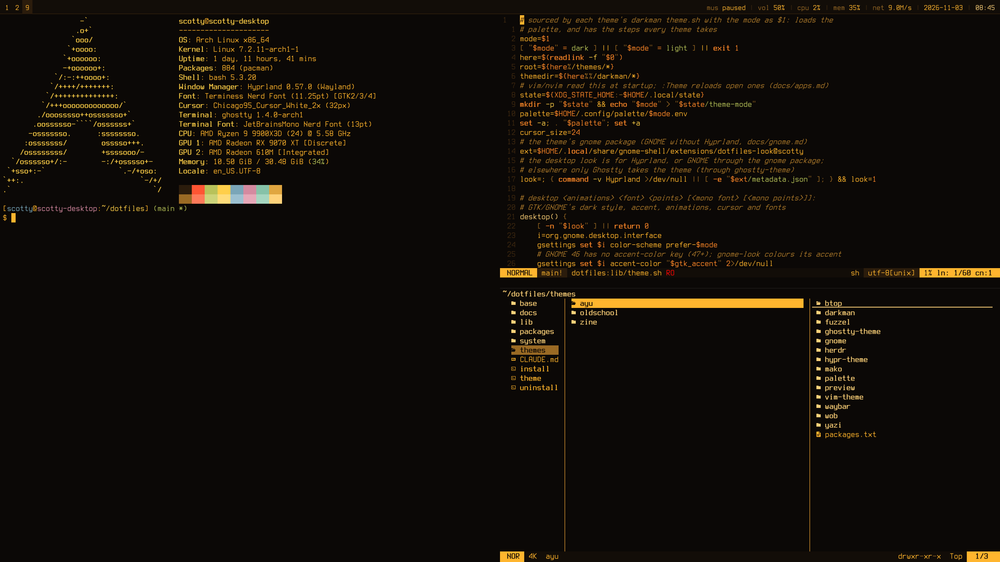
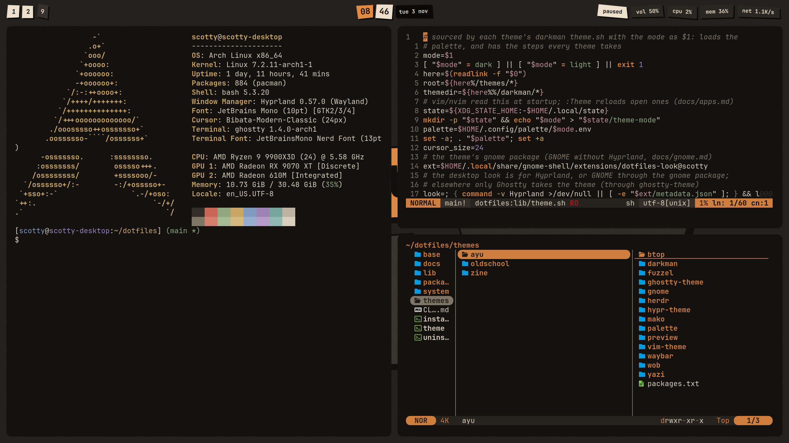
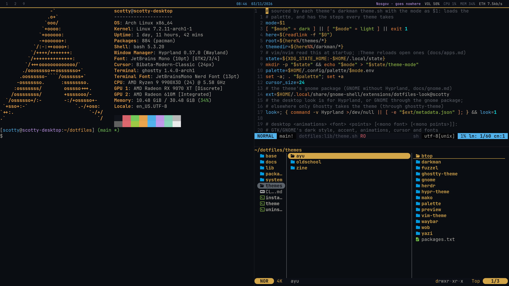

# dotfiles

Arch + Hyprland, with switchable themes; Debian/Ubuntu and GNOME get as
much as their apps allow. The shell, editors, keybinds and window rules
live once in `base/`, and each look is a theme in `themes/<name>/`, with
light and dark modes that follow darkman.

```
git clone git@github.com:ScottyOfTime/dotfiles.git ~/dotfiles
cd ~/dotfiles
./install          # pick a theme and what to link; lists missing packages
./theme <name>     # switch looks later
./uninstall        # put everything back
```

## Themes

### [oldschool](themes/oldschool)

An amber terminal: phosphor on black glass, and a flat text-only shell
with a tty login for a lock screen.

[](themes/oldschool)


### [zine](themes/zine)

A neo-brutalist zine: cream paper, ink outlines, one orange accent and
hard shadows on tilted paper scraps.

[](themes/zine)


### [ayu](themes/ayu)

The earlier rice: Ayu colours with waybar, fuzzel, mako and wob.

[](themes/ayu)


Each theme's README has light mode and the full palette. The strips are
dark mode on top and light mode below.

## Layout

```
base/       shared stow packages: bash, nvim, vim, ghostty, hypr, yazi, ...
themes/     one folder of stow packages per look
lib/        what install/theme/uninstall share; lib/distro/ for Arch vs Debian
packages/   package lists (Arch, AUR, Debian names)
system/     the sudo side: sddm.conf, services
docs/       how it all works
```

Start with [docs/README.md](docs/README.md).
