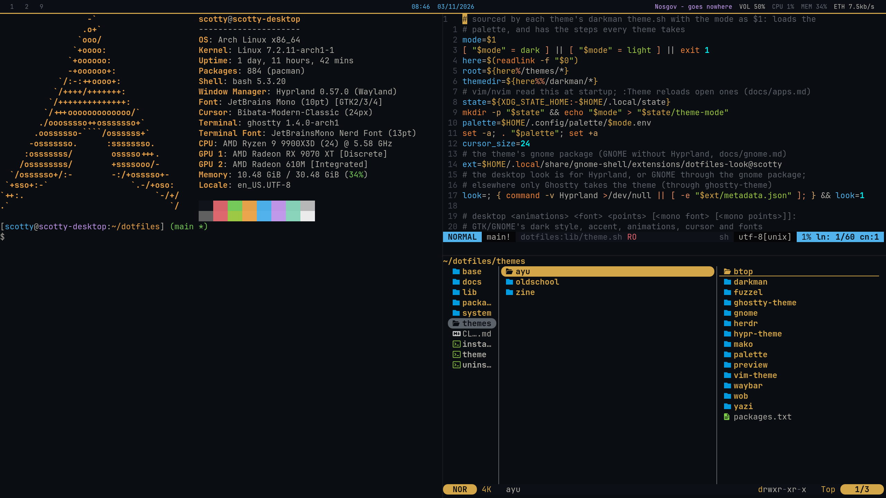
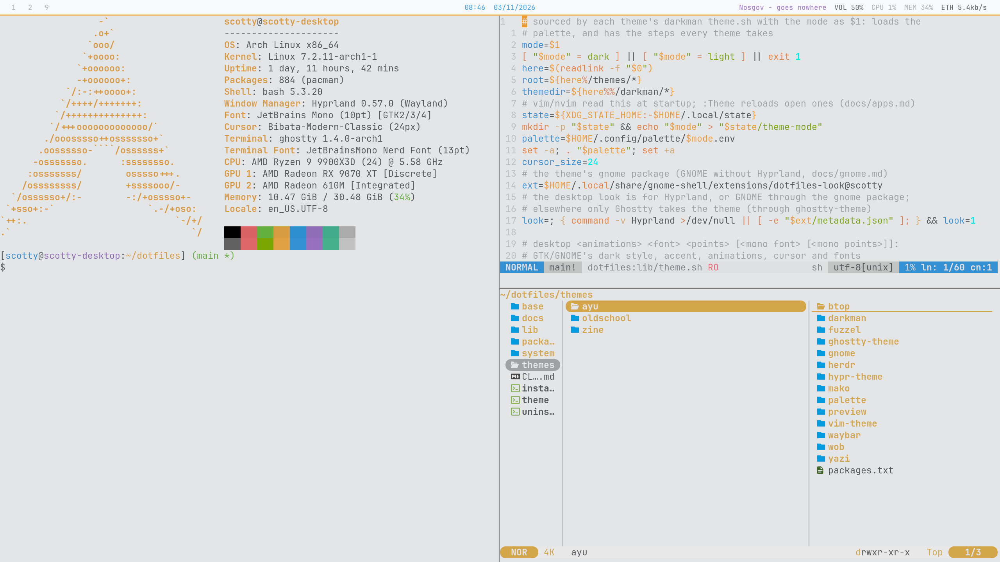
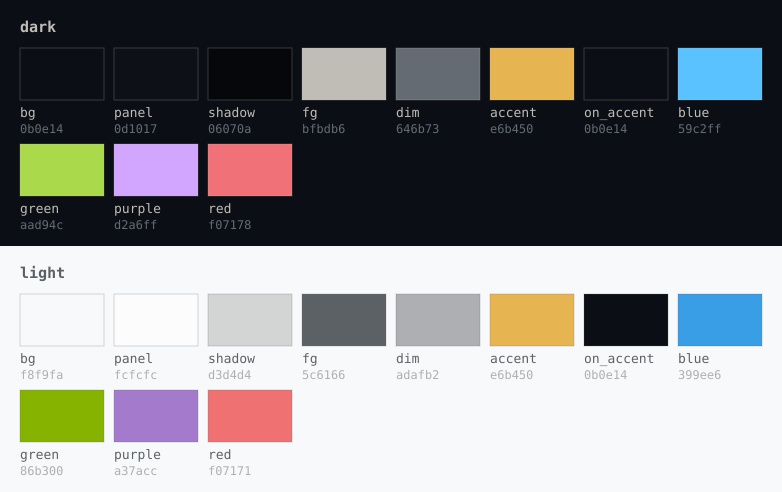

# ayu

The earlier rice: Ayu colours, flat and gapless, built from the pieces
used before Quickshell (waybar, fuzzel, mako and wob).

```
./theme ayu
```

| Dark | Light |
|---|---|
|  |  |

## Palette



The colours are hand-written in
[`palette/.config/palette/`](palette/.config/palette) (`dark.env`,
`light.env`). Ghostty uses its built-in Ayu themes; vim and nvim get
`ayu`, rendered from the palette.

<!-- palette: lib/previews fills this in -->
| Role | Dark | Light | Used for |
|---|---|---|---|
| `bg` | `0b0e14` | `f8f9fa` | wallpaper (solid, via swaybg), bar |
| `panel` | `0d1017` | `fcfcfc` | lock screen field, notification progress, GNOME |
| `shadow` | `06070a` | `d3d4d4` | window shadows, GNOME cards |
| `fg` | `bfbdb6` | `5c6166` | text |
| `dim` | `646b73` | `adafb2` | secondary text, empty workspaces |
| `accent` | `e6b450` | `e6b450` | active workspace, launcher and notification borders, high load |
| `on_accent` | `0b0e14` | `0b0e14` | text on `accent` (GNOME) |
| `blue` | `59c2ff` | `399ee6` | the bar's clock |
| `green` | `aad94c` | `86b300` | battery |
| `purple` | `d2a6ff` | `a37acc` | the playing track |
| `red` | `f07178` | `f07171` | urgent workspaces, critical load, errors |
<!-- /palette -->

## The look

- **Windows:** no gaps or borders, a soft shadow, and 8% dimming when
  unfocused, with Hyprland's stock animations.
- **Bar:** waybar, with an accent underline and workspace highlights.
- **Launcher:** fuzzel (`SUPER+Space`). **Notifications:** mako.
  **Volume and brightness:** wob.
- **Lock:** hyprlock, password box only.
- **Type:** JetBrains Mono. The cursor is Bibata Modern Classic.

## Needs

`waybar`, `fuzzel`, `mako`, `wob`, `swaybg` and `hyprlock`
([`packages.txt`](packages.txt)).

More: [ayu.md](../../docs/ayu.md).
