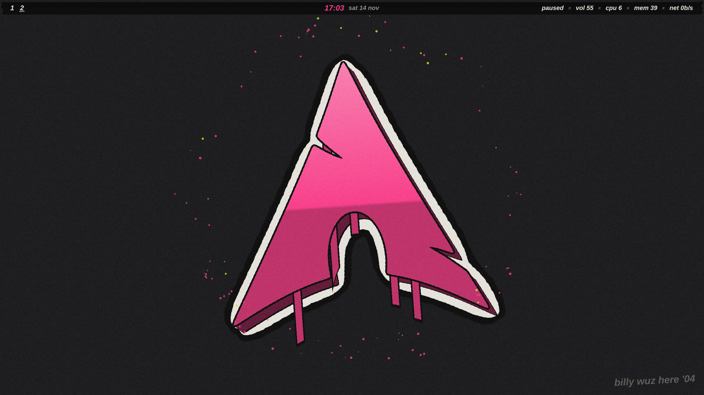
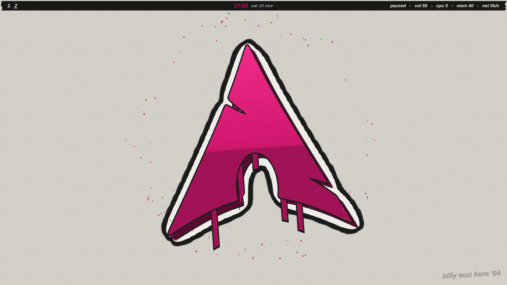
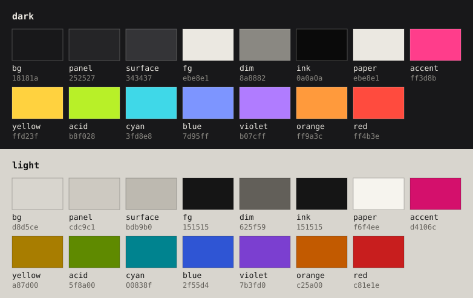

# billy

2000s punk, low tech: the distro's logo sprayed graffiti-style on a bare
wall, and a shell made of what was lying around: black gaffer tape
written on in paint marker, spray paint, label-maker tape, a mixtape.
Nothing is tilted and nothing casts a shadow. Things go up in hard steps
rather than gliding, and nothing springs. One hot pink can does all the
UI; an acid green one only shows up in the overspray.

```
./theme billy
```

| Dark | Light |
|---|---|
|  |  |

## Palette



The source is [`colorscheme/billy.toml`](colorscheme/billy.toml) (same
pipeline as zine). The UI uses the neutrals and `accent`; the
highlighter inks are for the terminal and editors, and `red` is only for
errors.

<!-- palette: lib/previews fills this in -->
| Role | Dark | Light | Used for |
|---|---|---|---|
| `bg` | `18181a` | `d8d5ce` | the wall: wallpaper, lock |
| `panel` | `252527` | `cdc9c1` | herdr, btop, GNOME panels |
| `surface` | `343437` | `bdb9b0` | inactive window borders, label tape for a workspace shown elsewhere |
| `fg` | `ebe8e1` | `151515` | body text |
| `dim` | `8a8882` | `625f59` | the marker tag on the wall |
| `ink` | `0a0a0a` | `151515` | gaffer and label tape, outlines |
| `paper` | `ebe8e1` | `f6f4ee` | paint-marker writing, the logo's cloud outline |
| `accent` | `ff3d8b` | `d4106c` | spray: the logo, the focused window's border, the focused workspace, picks |
| `yellow` | `ffd23f` | `a87d00` | terminal and editors |
| `acid` | `b8f028` | `5f8a00` | terminal and editors; the second can in the overspray |
| `cyan` | `3fd8e8` | `00838f` | terminal and editors |
| `blue` | `7d95ff` | `2f55d4` | terminal and editors |
| `violet` | `b07cff` | `7b3fd0` | terminal and editors |
| `orange` | `ff9a3c` | `c25a00` | terminal and editors |
| `red` | `ff4b3e` | `c81e1e` | errors, high load, a wrong password |
<!-- /palette -->

## The look

- **Wallpaper and lock:** os-release's `LOGO`, big and centred, as a
  piece: an ink and paper cloud outline, a 3D block, a two-tone pink
  face, overspray and drips running off its lower edges.
- **Windows:** square, 3px border, hot pink on the focused window and
  `surface` on the rest; no shadows, no blur, short straight animations.
- **Bar:** a strip of gaffer tape across the top, written on in paint
  marker; the focused workspace is circled in pink.
- **Shell:** the launcher (`SUPER+Space`) and notifications are gaffer
  tape too, the power menu (`SUPER+Escape`) stencils its words across the
  screen, volume and brightness are tally marks, the music popup is a
  cassette and the lock punches the password out on label tape.
- **Terminal:** Ghostty's tabs are label tape.

## Needs

`quickshell`, `hyprlock` and `ttf-liberation` (the marker hand)
([`packages.txt`](packages.txt)), plus the shared set from `./install`.

More: [billy.md](../../docs/billy.md).
