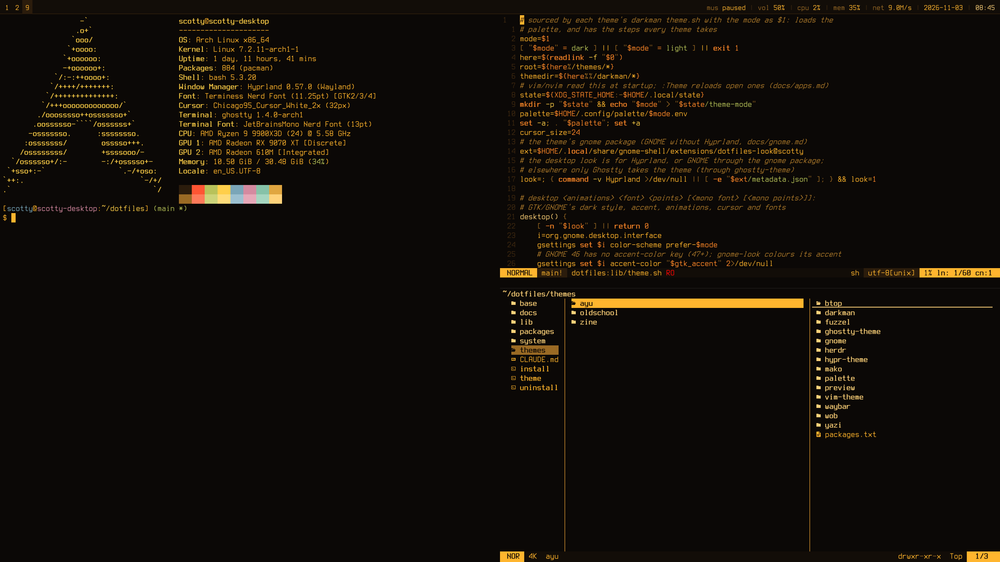
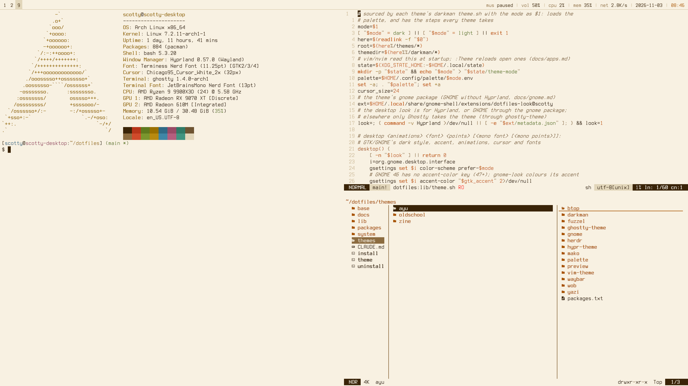
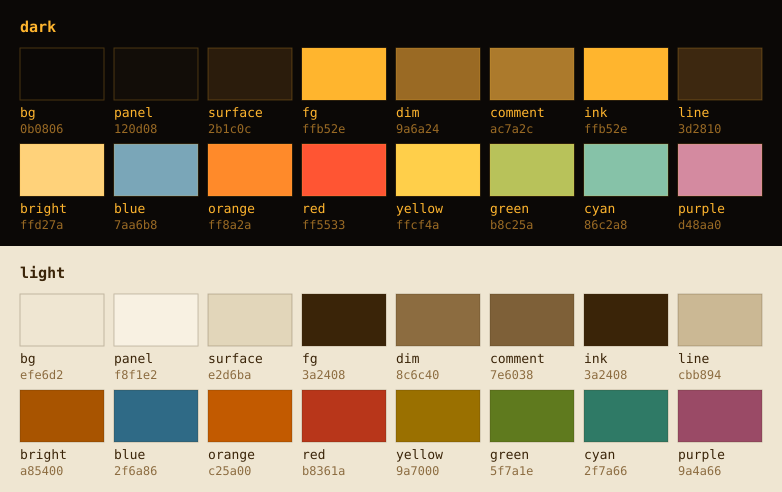

# oldschool

An amber terminal: phosphor amber on near-black glass, and a flat,
text-only shell after sxwm. There are no gaps, borders or animations, the
bar is `key: value`, the menus are dmenu-style strips, and a tty login is
the lock screen. Light mode is brown ink on warm paper.

```
./theme oldschool
```

| Dark | Light |
|---|---|
|  |  |

## Palette



The source is [`colorscheme/oldschool.toml`](colorscheme/oldschool.toml)
(same pipeline as zine). There's a single phosphor: everything is `fg`,
and selection is reverse video (an `fg` fill with `bg` text). The colours
from `blue` on are warm-shifted, for the terminal and editors only.

<!-- palette: lib/previews fills this in -->
| Role | Dark | Light | Used for |
|---|---|---|---|
| `bg` | `0b0806` | `efe6d2` | the tube: wallpaper, lock, overview; text on reverse video |
| `panel` | `120d08` | `f8f1e2` | bar, strips, boxes |
| `surface` | `2b1c0c` | `e2d6ba` | workspace shown on an unfocused monitor |
| `fg` | `ffb52e` | `3a2408` | phosphor: text, reverse-video fill, outlines |
| `dim` | `9a6a24` | `8c6c40` | keys, titles, secondary text |
| `comment` | `ac7a2c` | `7e6038` | editor comments (between `dim` and `fg`, so they stay readable) |
| `ink` | `ffb52e` | `3a2408` | same as `fg`, for the editors and herdr |
| `line` | `3d2810` | `cbb894` | the bar's underline, box edges, the logo burned into the wallpaper |
| `bright` | `ffd27a` | `a85400` | small text accents only: the clock, hovered `[buttons]` |
| `blue` | `7aa6b8` | `2f6a86` | terminal and editors |
| `orange` | `ff8a2a` | `c25a00` | terminal and editors |
| `red` | `ff5533` | `b8361a` | errors |
| `yellow` | `ffcf4a` | `9a7000` | terminal and editors |
| `green` | `b8c25a` | `5f7a1e` | terminal and editors |
| `cyan` | `86c2a8` | `2f7a66` | terminal and editors |
| `purple` | `d48aa0` | `9a4a66` | terminal and editors |
<!-- /palette -->

## The look

- **Windows:** no gaps and no borders. A 3px `fg` strip marks the focused
  window when a workspace has several. The floating drop-down and Files
  terminals get a 2px outline.
- **Shell (Quickshell):** a `key: value` bar with `[#####-----]` meters,
  dmenu-style launcher and font strips, text notifications, and a lock
  screen that is the distro logo over a tty login prompt.
- **tty-isms:** login, unlock and scratchpads warm up like a tube (a
  third, two thirds, then full brightness), and locking cuts to black and
  scans the prompt in. Nothing else animates, GTK included.
- **Type:** Terminus everywhere (an unhinted outline copy for Ghostty),
  or any monospace font from `SUPER+SHIFT+F`. The cursor is the Windows 95
  arrow, scaled up 2x and 3x.
- **Apps:** Ghostty (flat text tabs), vim/nvim, herdr, yazi (amber icons),
  btop (block graphs), htop (Monochrome); GNOME through the `gnome`
  package. `system/install-sddm` makes the lock screen the login screen.

## Needs

`quickshell`, `hyprlock`, `htop`, `ttf-terminus-nerd` and
`xcursor-chicago95-git` (AUR), plus `upower` for a laptop's battery
([`packages.txt`](packages.txt)).

More: [oldschool.md](../../docs/oldschool.md).
