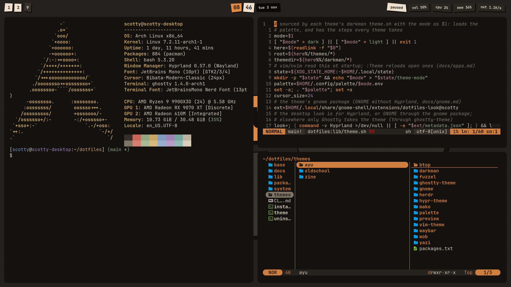
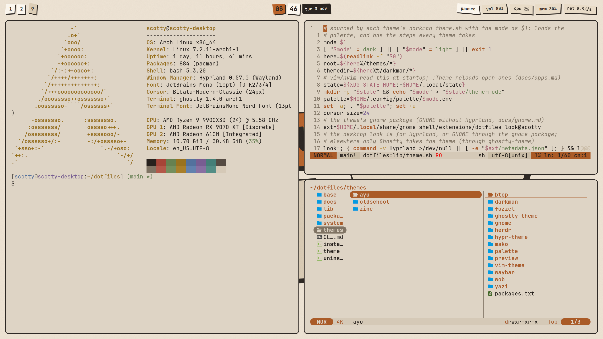
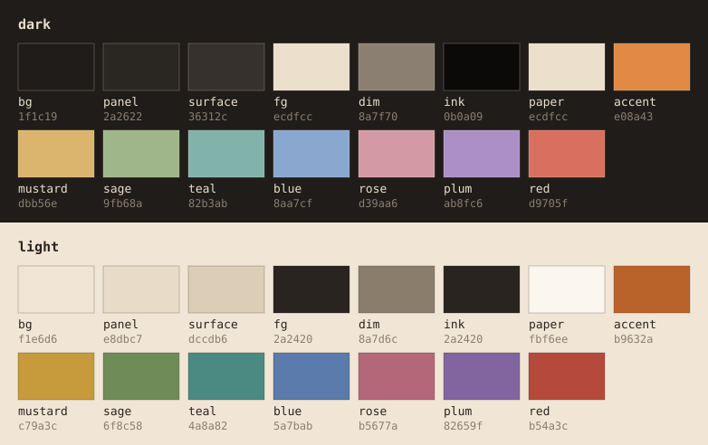

# zine

A neo-brutalist zine: cream paper, black ink slabs, one orange accent and
hard, unblurred shadows. The UI is made of slightly rotated paper scraps
that pop into place.

```
./theme zine
```

| Dark | Light |
|---|---|
|  |  |

## Palette



The source is [`colorscheme/zine.toml`](colorscheme/zine.toml). `build.py`
turns it into the palette, Ghostty, herdr and vim colours, and darkman
renders every other app from the palette. The UI uses only the neutrals
and `accent`. The riso inks are for the terminal and editors, and `red` is
only for errors.

<!-- palette: lib/previews fills this in -->
| Role | Dark | Light | Used for |
|---|---|---|---|
| `bg` | `1f1c19` | `f1e6d6` | page, wallpaper base |
| `panel` | `2a2622` | `e8dbc7` | scraps: bar modules, launcher, popups |
| `surface` | `36312c` | `dccdb6` | hover, workspace shown on another monitor |
| `fg` | `ecdfcc` | `2a2420` | body text |
| `dim` | `8a7f70` | `8a7d6c` | secondary text, placeholders |
| `ink` | `0b0a09` | `2a2420` | outlines, hard shadows, text on light scraps |
| `paper` | `ecdfcc` | `fbf6ee` | light scraps in both modes (inactive workspaces, clock minutes, music) |
| `accent` | `e08a43` | `b9632a` | focus, active workspace, selection, tape, the focused window's shadow |
| `mustard` | `dbb56e` | `c79a3c` | riso ink: terminal and editors |
| `sage` | `9fb68a` | `6f8c58` | riso ink: terminal and editors |
| `teal` | `82b3ab` | `4a8a82` | riso ink: terminal and editors |
| `blue` | `8aa7cf` | `5a7bab` | riso ink: terminal and editors |
| `rose` | `d39aa6` | `b5677a` | riso ink: terminal and editors |
| `plum` | `ab8fc6` | `82659f` | riso ink: terminal and editors |
| `red` | `d9705f` | `b54a3c` | errors, critical load |
<!-- /palette -->

## The look

- **Windows:** 10px rounding, a 2px ink border, 8/16px gaps and a sharp
  6px accent shadow under the focused window only.
- **Shell (Quickshell):** a bar of paper scraps, a taped launcher
  (`SUPER+Space`), notifications, a music popup, an overview
  (`SUPER+Tab`), a power menu (`SUPER+Escape`) and a password-only lock
  screen. Everything overshoots and settles (`OutBack`) quickly.
- **Wallpaper:** a live collage (a card, a circle, a banner with the
  hostname, tape and halftone dots) that drops in piece by piece.
- **Type:** JetBrains Mono everywhere, bold in the UI. The cursor is
  Bibata Modern Classic.
- **Apps:** Ghostty, vim/nvim, tmux, herdr, yazi and btop share the palette;
  GNOME gets it through the `gnome` package.

## Needs

`quickshell` and `hyprlock` ([`packages.txt`](packages.txt)), plus the
shared set from `./install`.

More: [zine-theme.md](../../docs/zine-theme.md) (the look),
[zine-pipeline.md](../../docs/zine-pipeline.md) (how colours reach every
app) and [zine-quickshell.md](../../docs/zine-quickshell.md) (the shell).
